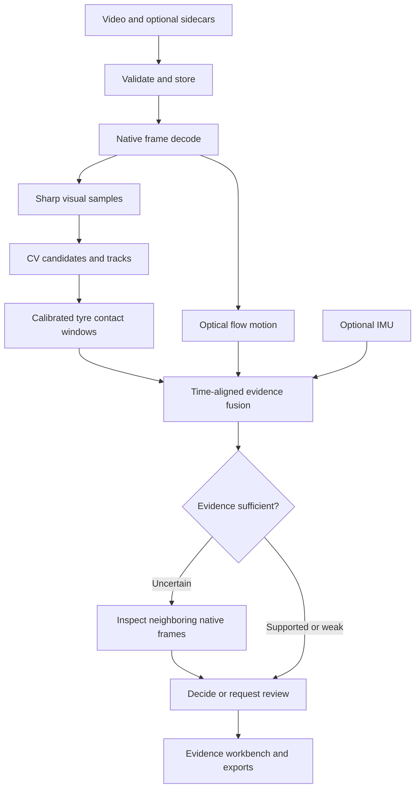

# Architecture and decision behavior

The FastAPI app runs one analysis worker and permits two outstanding jobs total. SQLite stores jobs/findings/trace/reviews. Videos/crops/reports live locally or in S3. The worker is in-process, not durable: a restart marks interrupted jobs failed, requiring reupload. The deployment must run exactly one Uvicorn worker/replica. A production multi-user service needs a durable external queue and account-level authorization.

## Decision table

| Visual evidence | Contact estimate | Motion | Result |
|---|---|---|---|
| Strong, persistent | No contact expected | Absent | Supported visual/no-contact; absence of shock is not a negative label |
| Strong | Contact expected | Time-aligned camera pulse | Motion-correlated visual support; not independently verified physical contact |
| Strong + real-trained model threshold | Contact expected | Valid IMU + learned association threshold | Impact-supported pilot result |
| Weak | Any | Strong shock | Dismissed or review; shock cannot create a pothole |
| Strong | Unknown | Missing | Visual-only support; contact unknown |
| Several tracks share pulse | Contact expected | Pulse | Human review; no exclusive attribution |
| Mixed | Any | Any | Native-frame reinspection, then review if still uncertain |

`confirmed` is a legacy database status meaning automated visual support, not ground truth. The UI distinguishes evidence classes and saved human approval. Heuristic confidence and image-based severity are not calibrated probabilities, physical depth or maintenance costs. The PDF excludes pending/rejected/dismissed findings; all candidates remain available in JSON.

The agent is a bounded deterministic policy, not an LLM. Its trace records the actual observations that selected a reinspection action and the resulting score. Bicubic/unsharp zooms are inspection aids, never new measurements.

## Coordinates and timing

Frames retain decoder presentation timestamps; a nominal-FPS fallback is recorded if timestamps do not advance. Visual detections use a maximum dimension of 640, with normalized boxes stored for display at the original video aspect ratio. Motion uses all decoded frames at 320×180. It fits a RANSAC affine transform to LK feature tracks, subtracts a local trend and computes a robust anomaly score. It does not fully segment moving objects or compensate rolling shutter.

Calibration maps normalized input image points to the road plane in metres, x right, y ahead of the front axle. Input videos and calibration must share the same rectification, lens, crop, mount and orientation. No lens undistortion is applied by this version. Bounding-box bottom widths approximate lateral extent. The two tyre strips include uncertainty; the between-tyres gap is preserved. Straight-path validation is required. Time of front contact is observation time + distance/speed; rear timing adds wheelbase/speed. Only windows fully inside the recording are used.

Missing calibration, inconsistent overlap/arrival times, unreliable speed or out-of-video contact produces unknown. Fixed calibration is inappropriate during a turn, changing mount pose, steep nonplanar road or strong pitch/roll; mark the entire clip invalid for contact in such cases. Future work should estimate a changing path.

## Source map

| Path under roadreport | Responsibility |
|---|---|
| backend/app/main.py | API, validation, queue, auth, evidence serving, review/export |
| backend/app/pipeline.py | Explicit integration and persistence |
| backend/app/cv/video.py | Bounded decoding and separate sample streams |
| backend/app/cv/pothole.py, crack.py | Original classical visual proposals |
| backend/app/cv/track.py | Greedy temporal linking, gap limit, stable best-frame lookup |
| backend/app/cv/contact.py, motion.py | Tyre geometry and impact windows |
| backend/app/agent.py | Adaptive inspection and trace |
| backend/app/ml | Features, training, portable inference, decision policy |
| backend/app/schemas.py | Versioned validated sidecars |
| backend/app/db.py, storage.py, report.py | Records, private media and PDF |
| backend/tools | Calibration fit and labeled-event preparation |
| backend/eval | Comparable event-level benchmark |
| frontend/src/App.jsx | Inspect/review/history workbench |
| frontend/src/components | Capture, motion plot and measured route |
